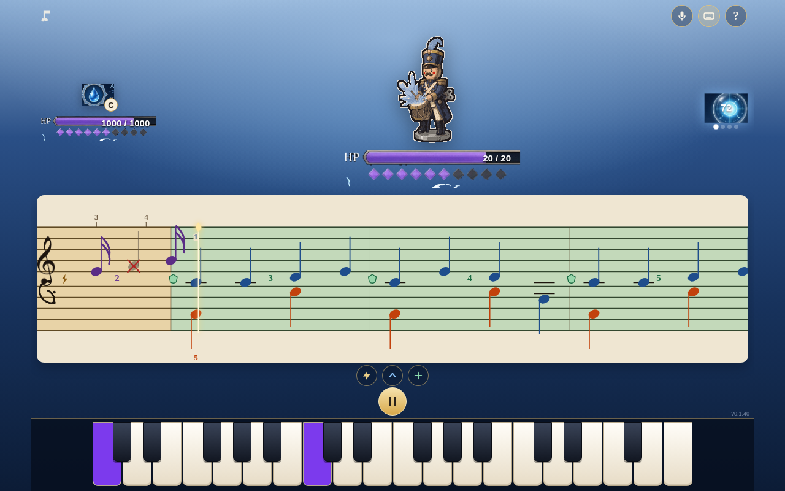

# 🎹 piano-magic

> Un combate RPG que se juega tocando piano: improvisa para atacar y copia la melodía del jefe para defenderte. Con teclado, MIDI o micrófono.

**[▶ Jugar ahora](https://juliangdeveloper.github.io/piano-magic/)** · gratis, en el navegador, sin instalar



## Cómo se juega
- Elige un rival (*Parade Feather*; *The Veil Boat*; *Tower Chime*; *New World Largo*; *Camptown Races*; *Eine Kleine Nachtmusik*) o el **Modo libre**.
- El combate alterna compases de **Ataque** y **Defiende** sobre una partitura que avanza al ritmo del metrónomo.
- En **Ataque** improvisas: escalas mayores atacan, menores te mejoran y pentatónicas te curan.
- En **Defiende** copias las dos manos. Un par a la vez es perfecto si suenan las dos notas, y parcial si solo entra una.
- Toca con el teclado QWERTY (baja hasta el Do3: `Q M , .`), el teclado en pantalla, un teclado MIDI o el micrófono. Cada mano tiene su color.
- El teclado en pantalla siempre está a la vista: la nota del jefe se enciende en morado y la tuya en verde.
- Al inicio de cada frase un número indica el dedo (1–5): arriba para la mano derecha, abajo para la izquierda.
- La primera vez hay un tutorial; **?** lo vuelve a abrir y **P** pausa.

## Stack
JavaScript vanilla, Web Audio y Web MIDI. La detección de notas se carga en vivo desde el motor de [piano-transcribe](https://github.com/juliangdeveloper/piano-transcribe) (`engine/v1`). El juego solo lee las notas y dibuja su combate. Sin dependencias de npm y sin copia local del detector.

```
python3 -m http.server 8000   # abrir http://localhost:8000 (file:// no carga los charts)
npm test                      # tests en Node, sin npm install
```

## Relacionado
🎼 [piano-transcribe](https://github.com/juliangdeveloper/piano-transcribe): motor de notas y partitura en vivo. [Probar](https://juliangdeveloper.github.io/piano-transcribe/)

---

Más proyectos: https://juliangdeveloper.github.io/

Hecho con ❤️ y 🎹
