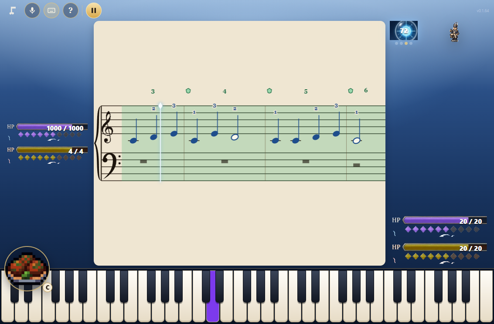

# 🎹 piano-magic

> Un combate RPG que se juega tocando piano: improvisa para atacar y copia la melodía del jefe para defenderte. Con teclado, MIDI o micrófono.

**[▶ Jugar ahora](https://juliangdeveloper.github.io/piano-magic/)** · gratis, en el navegador, sin instalar



## Cómo se juega
- Elige un rival (*Parade Feather*; *The Veil Boat*; *Tower Chime*; *New World Largo*; *Camptown Races*; *Eine Kleine Nachtmusik*; *Jingle Bells*; *Surprise Symphony*; *Morning*; *Simple Gifts*) o el **Modo libre**.
- El combate alterna compases de **Ataque** y **Defiende** sobre una partitura que avanza al ritmo del metrónomo.
- En **Ataque** improvisas: escalas mayores atacan, menores te mejoran y pentatónicas te curan.
- En **Defiende** copias las dos manos: la derecha en clave de sol y la izquierda en clave de fa. Un par a la vez es perfecto si suenan las dos notas, y parcial si solo entra una.
- Toca con el teclado QWERTY (baja hasta el Do3: `Q M , .`), el teclado en pantalla (Do2 a Do7, 61 teclas), un teclado MIDI o el micrófono. El micrófono cubre esas 61 teclas. Cada mano tiene su color. El juego sigue sonando si enciendes el micrófono.
- El teclado en pantalla siempre está a la vista: la nota del jefe se enciende en morado y la tuya en verde, al mismo tiempo que el indicador pasa por la nota y suena.
- Los números junto a las notas indican el dedo (1–5): arriba para la mano derecha, abajo para la izquierda.
- Las notas ligadas se tocan una sola vez.
- El jefe toca con las dinámicas de la partitura: *p*, *f*, reguladores y staccato cambian su volumen y su duración.
- Para practicar, abre la partitura del rival (o pausa el combate), elige una sección y escúchala en loop a tempo real, ×0.75 o ×0.5. **Practicar** inicia un combate con ese loop, y no cuenta como pelea real.
- La primera vez hay un tutorial; **?** lo vuelve a abrir y **P** pausa.
- La nota musical abre el volumen de **Piano** (teclas y partitura) y **Metrónomo**; se guarda en el dispositivo.

## Stack
JavaScript vanilla, Web Audio y Web MIDI. La detección de notas se carga en vivo desde el motor de [piano-transcribe](https://github.com/juliangdeveloper/piano-transcribe) (`engine/v1`). El juego solo lee las notas y dibuja su combate. Sin dependencias de npm y sin copia del detector en el repo.
Al abrirse guarda el progreso en `localStorage` (`meta.v1.piano-magic`), que lee el [portafolio](https://juliangdeveloper.github.io/).

```
python3 -m http.server 8000   # abrir http://localhost:8000 (file:// no carga los charts)
npm test                      # tests en Node, sin npm install
```

## App iOS
`ios/` envuelve el juego en una app SwiftUI con `WKWebView` y lee teclados MIDI por CoreMIDI. Al compilar, `ios/sync-web.sh` copia los archivos web y el motor `engine/v1` fijado, así que la app funciona sin conexión. La versión de la app es la de `VERSION` y el build es el número de ejecución del workflow. El bundle ID está en `ios/xtool.yml`.

```
sh ios/sync-web.sh && cd ios && xtool dev build   # local, Linux o macOS
```

`.github/workflows/ios.yml` (runner `macos-26`):
- Cada push a `main` o `ios-testflight` genera el proyecto con XcodeGen, corre los tests de Swift y hace un archive sin firmar.
- **Run workflow** con *Subir a TestFlight* firma con una API key de App Store Connect y sube el build.
  - Secrets: `ASC_KEY_ID`, `ASC_ISSUER_ID`, `ASC_KEY_P8` (contenido del `.p8`).
  - Variables: `IOS_TEAM_ID`, y `IOS_BUNDLE_ID` si cambia el bundle ID.

## Relacionado
🎼 [piano-transcribe](https://github.com/juliangdeveloper/piano-transcribe): motor de notas y partitura en vivo. [Probar](https://juliangdeveloper.github.io/piano-transcribe/)

---

Más proyectos: https://juliangdeveloper.github.io/

Hecho con ❤️ y 🎹
